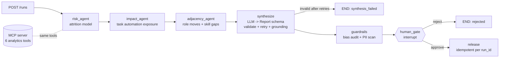

# Workforce Reinvention Copilot

A multi-agent, human-approved workforce analytics service. It answers: **which roles are exposed to AI automation,
which are at attrition risk, where can people realistically move, and what should HR do first** — and it will not
release a recommendation until a named human approves it.

Built to demonstrate production-readiness for GenAI talent/workforce solutions: structured outputs, evals with a
regression gate, tracing, human-in-the-loop gates, idempotent resumable runs, PII masking, bias auditing, and
secure deployment.

> **Data is 100% synthetic** (600 generated employees, 10 hand-written roles). No real people. Scores are illustrative.

## Architecture



| Concern | Where |
|---|---|
| Multi-agent orchestration, checkpointing | `src/wfr/graph.py` (LangGraph + SQLite checkpointer) |
| Structured outputs, retry, semantic validation | `src/wfr/llm.py`, `src/wfr/schemas.py` |
| Tool use + MCP | `src/wfr/tools.py`, `src/wfr/mcp_server.py` |
| Human-in-the-loop gate | `human_gate` node (`interrupt`) + `POST /runs/{id}/decision` |
| Evals + regression gate | `evals/run_evals.py`, `evals/baseline.json`, CI |
| Tracing, cost, latency | `src/wfr/tracing.py` (JSONL spans; `GET /runs/{id}/trace`) |
| Idempotency / retries | tool-call cache keyed on args; release file keyed on `run_id`; checkpoint resume |
| PII | `src/wfr/pii.py` — LLM sees employee IDs + aggregates only |
| Governance | `src/wfr/governance.py` (bias audit, grounding), `docs/MODEL_CARD.md` |
| Auth, secrets, deploy | `src/wfr/api.py` (API key, fails closed), `Dockerfile`, env-injected secrets |

## Run it

```bash
pip install -r requirements.txt pytest
python scripts/make_data.py          # regenerates the seeded synthetic data
pytest -q                            # 19 tests
python evals/run_evals.py            # golden evals + regression gate (exit 1 on regression)

export WFR_API_KEY=change-me
uvicorn wfr.api:app --port 8000
curl -s -XPOST localhost:8000/runs -H "X-API-Key: $WFR_API_KEY" -H 'content-type: application/json' -d '{}'
curl -s -XPOST localhost:8000/runs/<run_id>/decision -H "X-API-Key: $WFR_API_KEY" \
     -H 'content-type: application/json' -d '{"decision":"approve","reviewer":"Your Name"}'

python -m wfr.mcp_server             # MCP tools over stdio (Claude Desktop etc.)
```

Real model: `WFR_LLM=bedrock` (+ `WFR_BEDROCK_MODEL`, IAM role credentials). Default is `mock` (deterministic, offline).

## What is verified vs. not

**Verified here** (run in CI): 19 tests; 10 eval metrics; the live HTTP flow (auth → run → approve → 409 on replay);
restart-resume from the checkpoint DB; the evals were mutation-tested (disabling the grounding guard, auto-approving the
gate, and scrambling retrieval each make the relevant metric fail).

**Not verified: the Bedrock path.** `BedrockLLM` (forced tool-call structured output) is written but has not been run
against a live account. Run it once with real credentials, and compare its eval scores to the mock's, before claiming it.

## Honest limitations

- The mock LLM produces the report from a template, so the eval scores for *report quality* are really scores for the
  pipeline around the model (schema, grounding, gate), not for model judgement. Add LLM-as-judge or human-rated evals
  when a real model is wired in.
- Automation scores in `data/taxonomy.json` are hand-assigned. Real use needs O*NET/ESCO task data and client validation.
- Skill-overlap adjacency ignores seniority, pay, geography and willingness to move. Roles with no overlap >= 0.15 get no
  suggested move (e.g. Recruiter), which is a deliberate "no realistic path" rather than a forced one.
- Bias audit: with 600 rows and 30 people over 45, the four-fifths ratio is noisy. The audit therefore returns
  pass / **review** / fail using an omnibus chi-square test. Current result is **review** for both gender and age band
  (ratios 0.68 and 0.48, p = 0.08 and 0.10: not significant, but not clearly fine). That goes to the human approver.
- Attrition model is a logistic regression (CV AUC 0.77 on synthetic data built from a known function, so this number
  says the model can recover a signal, not how it would do on real HR data).
- Employee-level attrition predictions are sensitive. In real deployments they need a lawful basis, works-council /
  consent review and access control that this demo does not implement.

## 5-minute demo script

1. Problem (60s): HR wants to know where AI changes roles and who is at risk of leaving, without leaking employee data.
2. Live run (90s): `POST /runs` → show the draft, the bias flag (`review`), and `pii_leaks_in_prompts: 0`.
3. Break it on purpose (60s): run `pytest -k hallucinated` / show `MockLLM(hallucinate_ids=True)` being **blocked** by the grounding check.
4. Approve (30s): show the 409 on a second approval and the single released file.
5. Evals + trace (60s): `python evals/run_evals.py`, then `GET /runs/{id}/trace` for tokens, cost, latency, retries.
